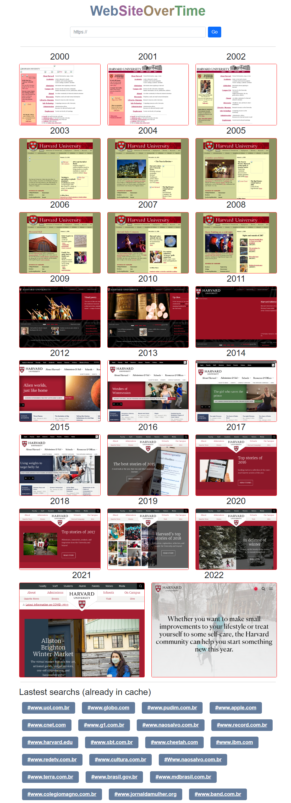
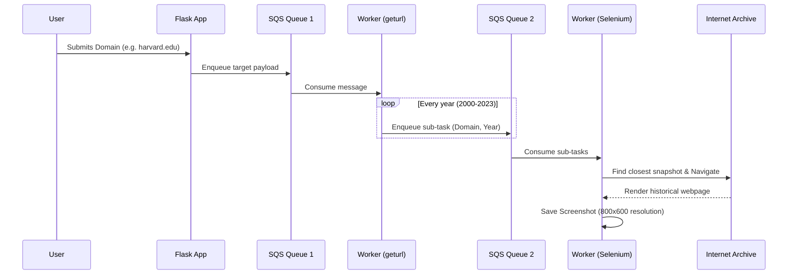

<h1 align="center">
  🌐 Website Over Time
</h1>

<p align="center">
  <strong>A Historical Journey Through the Web's Evolution.</strong>
</p>

<p align="center">
  
</p>

<p align="center">
  <a href="#about-the-project">About The Project</a> •
  <a href="#how-it-works">How It Works</a> •
  <a href="#architecture">Architecture</a> •
  <a href="#getting-started">Getting Started</a> •
  <a href="#documentation">Documentation</a>
</p>

---

## 📖 About The Project

As someone deeply fascinated by the dawn of the internet, I created **Website Over Time** to observe the visual transformation of web design over decades.

Starting with any URL (e.g., `www.harvard.edu`), this project leverages the digital library of the internet—the **[Internet Archive (Wayback Machine)](https://archive.org/)**—to crawl and retrieve the earliest snapshots form the year 2000 to the present day.

<details>
<summary><strong>🎥 Watch the Video Demo</strong></summary>
<br>
<a href="https://www.youtube.com/watch?v=FYucijjcUzA&ab_channel=LucianoCamilo">
  
</a>
</details>

## ⚙️ How It Works

Because scraping decades of history takes time, standard blocking web requests wouldn't cut it. The project relies on an asynchronous event-driven architecture using **AWS SQS** queues and multiple background workers pulling the heavy weight.

### Event Flow (Diagram)



> **Why 800x600 resolution?** Websites at the beginning of the century were designed for smaller CRT monitors. Forcing higher resolutions destroys the nostalgic sensation!

## 🏗️ Architecture

The system exists in two main flavors:
1. **Local / VPS**: Python applications managed via basic execution or `systemd`, storing screenshots to the local disk (`./screenshots`).
2. **Serverless (Cloud)**: AWS Lambdas replacing standard python scripts, storing images in `AWS S3` giving it infinite scalability.

### Key Technologies
- **Backend Framework**: Flask
- **Event Bus**: AWS SQS (`.fifo` queues for deduplication)
- **Scraping Engine**: Selenium & Headless Chrome
- **Storage**: AWS S3 (Cloud version), local `os` directories (Local Version)

## 📁 Repository Structure

We have documented the internals of each module in the `/docs` folder:

| Module / Component          | Documentation Link                                                                                   |
| --------------------------- | ---------------------------------------------------------------------------------------------------- |
| Overall Architecture        | [`docs/system_architecture.md`](docs/system_architecture.md)                                         |
| Flask App Front-End         | [`docs/app.md`](docs/app.md)                                                                         |
| SQS URL Coordinator         | [`docs/sqs_geturl.md`](docs/sqs_geturl.md)                                                           |
| SQS Screenshot Scraper      | [`docs/sqs_getscreenshot.md`](docs/sqs_getscreenshot.md)                                             |
| Lambda Implementations      | [`docs/app_lambda.md`](docs/app_lambda.md), [`docs/sqs_geturl_lambda.md`](docs/sqs_geturl_lambda.md) |
| Scratch & Testing Utilities | [`docs/test_s3.md`](docs/test_s3.md)                                                                 |

## 🚀 Getting Started

### Prerequisites

You need the following installed:
- Python 3.8+
- [Selenium](https://pypi.org/project/selenium/) and the matching `chromedriver` version.
- [Boto3](https://boto3.amazonaws.com/v1/documentation/api/latest/index.html) configured with AWS API keys (for SQS/S3 integration).

### Installation

1. **Clone the repository:**
   ```bash
   git clone https://github.com/lucianomcsilva/WebsiteOverTime.git
   cd WebsiteOverTime
   ```

2. **Install requirements:**
   ```bash
   pip install -r requirements.txt
   ```

3. **Start the background SQS Workers:**
   ```bash
   python sqs_geturl.py &
   python sqs_getscreenshot.py &
   ```

4. **Boot the Flask Server:**
   ```bash
   python app.py
   ```
   Navigate to `http://localhost:5001/` to use the application!

## 🧪 Testing

This project contains simple sanity checks and S3 iteration queries using the AWS SDK (`test_s3.py`).

Run the storage diagnostic using:
```bash
python test_s3.py
```

*Note: Ensure your `boto3` environment is preconfigured with the right IAM policies before executing bucket read operations.*

---
_Built with ❤️ for the nostalgic web explorer._
