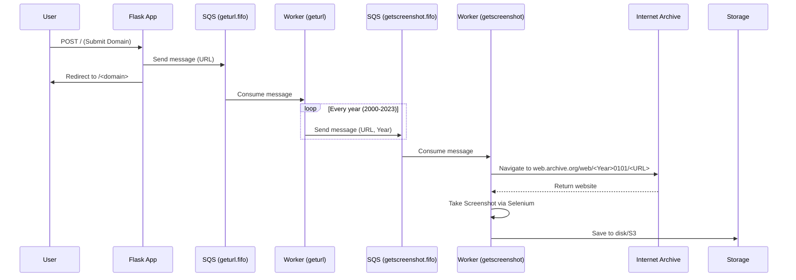

# System Architecture: Website Over Time

## Overview

**Website Over Time** is a web archiving and visualization system designed to chronologically capture and display the evolution of websites. It leverages the Internet Archive (Wayback Machine) to retrieve historical versions of websites spanning from 2000 to the present day.

The system is built on an event-driven architecture to ensure scalability and avoid blocking the frontend application during long-running web scraping tasks.

## Components

The architecture consists of three main components:

1. **Frontend Application (Flask)**: Serves the user interface, allows users to request new domains to crawl, and displays the galleries of captured screenshots.
2. **URL Processing Worker**: Listens for new domain requests via an AWS SQS queue. When a domain is requested, it generates a series of tasks (one for each year) and places them into a secondary queue.
3. **Screenshot Processing Worker**: Listens to the secondary SQS queue. For each task, it fires up a headless Chrome browser (via Selenium), navigates to the Internet Archive's snapshot of the domain for the requested year, captures a screenshot, and saves it.

## Execution Flow

## Cloud vs Local Implementations
The codebase includes two implementations:
- **Local/Lightsail**: Uses local file system (`./screenshots`) to store images and runs as standard python scripts (`app.py`, `sqs_geturl.py`, `sqs_getscreenshot.py`).
- **AWS Serverless/Lambda**: Uses AWS S3 for storage and AWS Lambda for execution, adjusting to a purely cloud-native architecture (`app_lambda.py`, `sqs_geturl_lambda.py`).

## Dependencies
- **Flask**: Web framework for the frontend.
- **Boto3**: AWS SDK for Python to interact with SQS and S3.
- **Selenium**: Browser automation to capture screenshots natively in Chrome.
- **Requests**: Fetch URLs dynamically to locate closest Internet Archive records.
